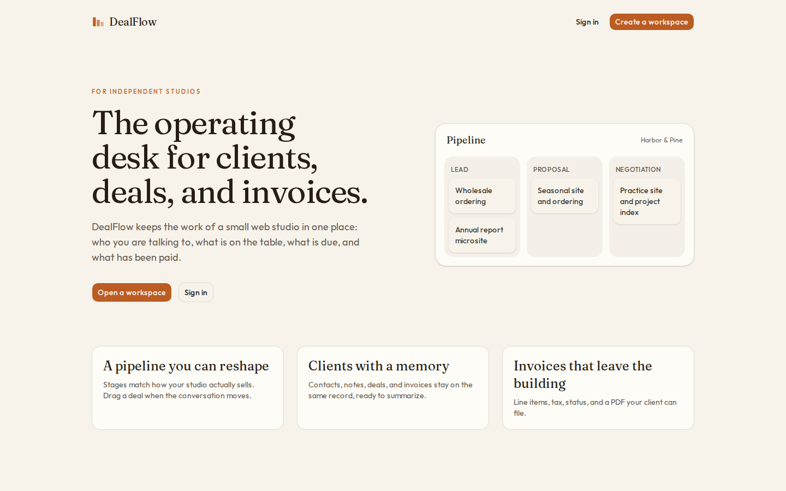
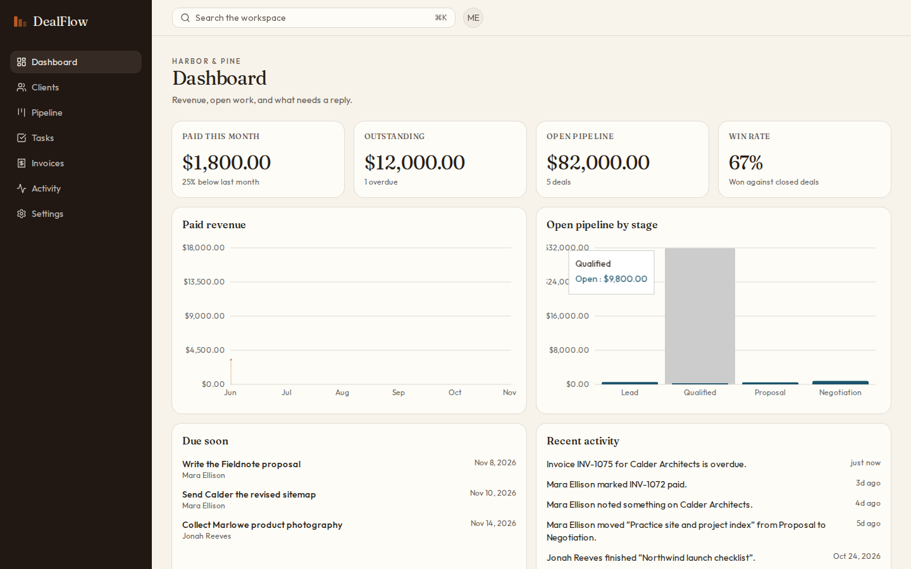
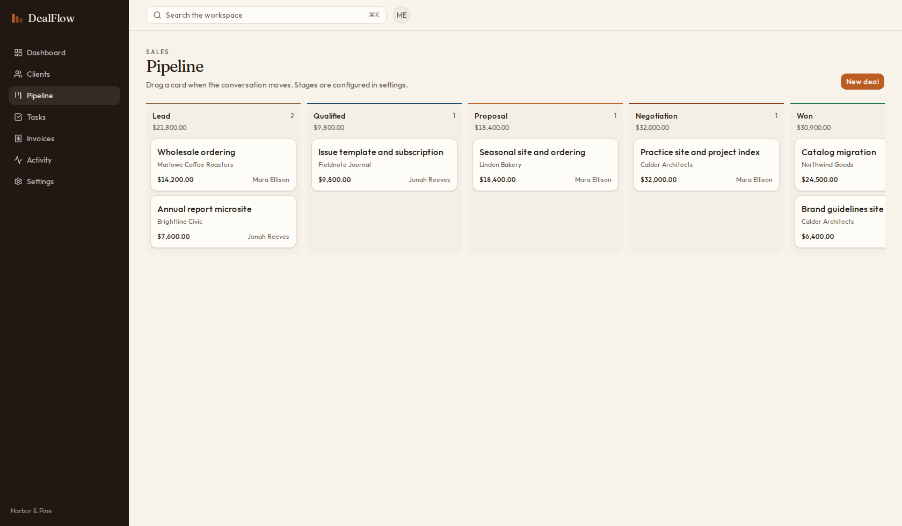
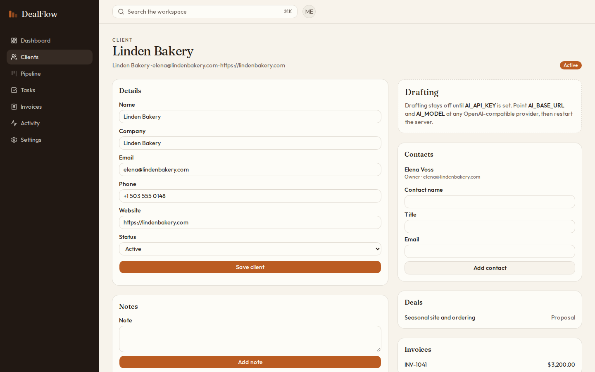
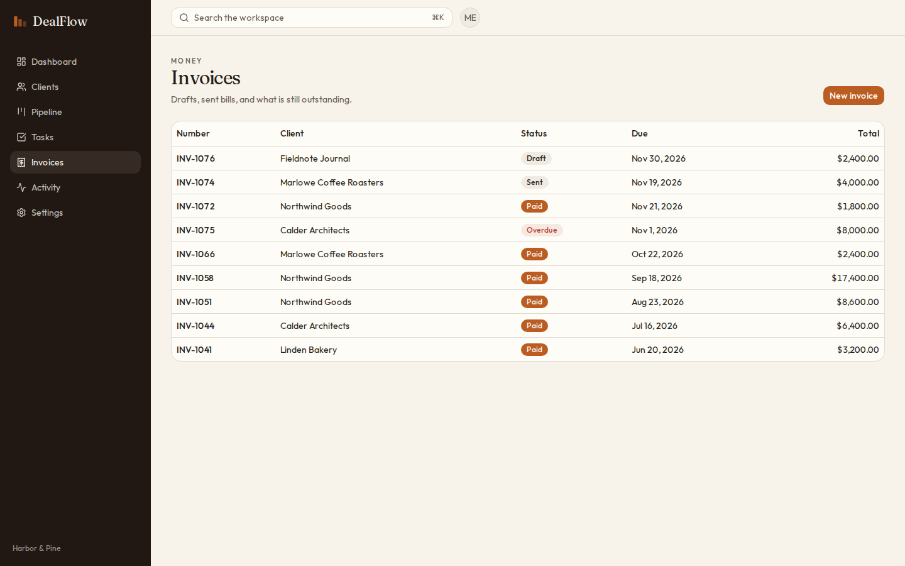
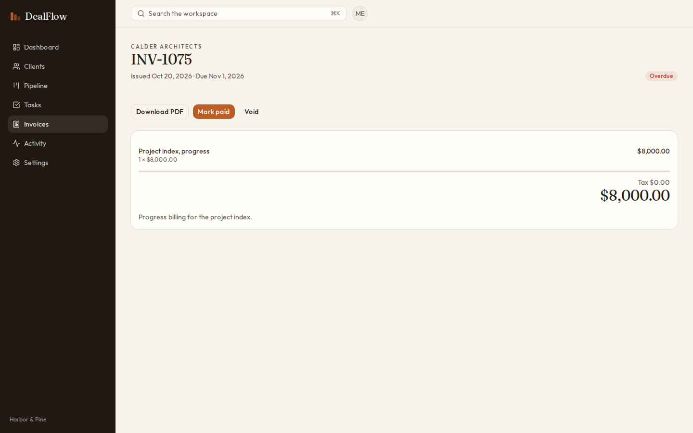
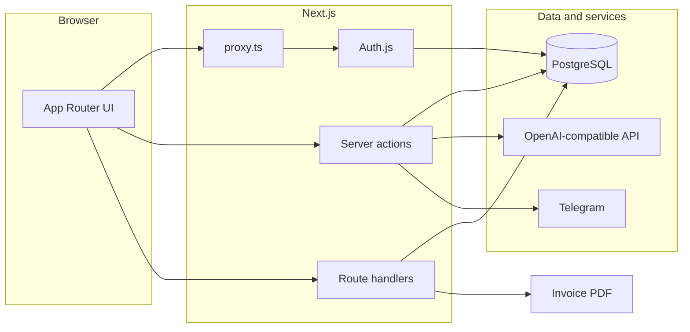

# DealFlow

DealFlow is the operating desk for freelancers and small web studios. It keeps clients, the sales pipeline, tasks, and invoices in one workspace, with a record of who changed what.

Owners and admins shape the pipeline and the team. Everyone on the workspace can run the day-to-day work: notes, deals, tasks, and bills.

## Коротко

DealFlow — рабочий стол небольшой веб-студии. В одном пространстве живут клиенты, сделки на канбан-доске, задачи и счета. Можно менять стадии воронки, приглашать команду с ролями, выгружать счёт в PDF и смотреть выручку на панели. Черновики писем и сводка по клиенту подключаются через любой OpenAI-совместимый API и просто молчат, если ключ не задан.

## Features

- Workspaces with owners, admins, and members, plus invites for people who do not have an account yet
- Clients with contacts, notes, deals, invoices, and open tasks
- Drag-and-drop pipeline with stages you can rename, reorder, color, and mark as won or lost
- Tasks with due dates, priority, and assignees
- Invoices with line items, tax, status changes, and PDF download
- Dashboard with paid revenue, outstanding balances, open pipeline value, and win rate
- Search across clients, deals, invoices, and tasks
- Activity log for the workspace
- Optional drafting: summarize a client or write a proposal and a reply through an OpenAI-compatible API
- Optional Telegram messages when a deal changes stage or an invoice becomes overdue

## Screenshots













## Architecture



The browser talks to a Next.js app. `src/proxy.ts` sends anonymous visitors to sign in. Auth.js issues a JWT for email and password, and for GitHub when those credentials are configured. Server actions mutate workspace data through Prisma. Route handlers serve search, invoice PDFs, a health check, and an overdue sweep. Drafting and Telegram are called only when their environment variables are present.

Money is stored in cents. Invoice totals, status changes, stage rules, and permissions live in `src/lib` so they can be checked without a database.

## Stack

- Next.js 16 (App Router) and React 19
- TypeScript (strict)
- PostgreSQL and Prisma
- Auth.js with credentials and optional GitHub
- Tailwind CSS and shadcn/ui
- Zod
- Recharts, dnd-kit, pdf-lib
- Vitest and Playwright
- Docker Compose and GitHub Actions

## Quick start

### Docker Compose

```bash
docker compose up --build
```

The app listens on [http://localhost:3000](http://localhost:3000). Postgres is published on host port **5433** so it does not collide with a local Postgres on 5432.

Load the Harbor & Pine workspace:

```bash
docker compose exec app pnpm db:seed
```

| | |
| --- | --- |
| Mara Ellison | `mara@harborandpine.studio` |
| Jonah Reeves | `jonah@harborandpine.studio` |
| Password | `Harborpine#2026` |

### Local

Requirements: Node.js 22, pnpm 10, and PostgreSQL 16.

```bash
cp .env.example .env
# Set AUTH_SECRET to a long random string, and DATABASE_URL if needed.
pnpm install
pnpm exec prisma generate
pnpm db:deploy
pnpm db:seed
pnpm dev
```

Open [http://localhost:3000](http://localhost:3000).

## Environment

| Variable | Required | Purpose |
| --- | --- | --- |
| `DATABASE_URL` | yes | PostgreSQL connection string |
| `AUTH_SECRET` | yes | Signs the session cookie |
| `AUTH_URL` | yes in production | Public URL of the app, used for auth redirects |
| `AUTH_TRUST_HOST` | behind a proxy | Trust the incoming host |
| `AUTH_GITHUB_ID` | no | GitHub OAuth client id. Hide the button by leaving this empty |
| `AUTH_GITHUB_SECRET` | no | GitHub OAuth client secret |
| `AI_API_KEY` | no | Turns on client summaries and drafts. Ollama accepts any non-empty value |
| `AI_BASE_URL` | no | OpenAI-compatible base URL. Defaults to `https://api.openai.com/v1` |
| `AI_MODEL` | no | Model name. Defaults to `gpt-4o-mini` |
| `TELEGRAM_BOT_TOKEN` | no | Bot token for workspace notifications |
| `CRON_SECRET` | no | Bearer token for `POST /api/jobs/overdue`. The route stays closed when this is empty |

Each workspace stores its own Telegram chat id under Settings → Notifications. The dashboard also marks sent invoices overdue when their due date has passed.

## Scripts

| Script | What it does |
| --- | --- |
| `pnpm dev` | Start the development server |
| `pnpm build` | Generate the Prisma client and build |
| `pnpm start` | Serve the production build |
| `pnpm lint` | ESLint |
| `pnpm typecheck` | `tsc --noEmit` |
| `pnpm test` | Vitest |
| `pnpm test:e2e` | Playwright |
| `pnpm format` | Prettier |
| `pnpm db:migrate` | Create a migration during development |
| `pnpm db:deploy` | Apply migrations |
| `pnpm db:seed` | Load Harbor & Pine for local development |

## Project structure

```
src/app            routes, screens, and route handlers
src/components     shell, forms, pipeline board, shadcn/ui
src/lib            money, invoices, permissions, prompts, auth
src/server         workspace access and server actions
prisma             schema, migrations, seed
e2e                Playwright flows
docs               product screenshots
```

## Roadmap

- Recurring invoices and retainers
- A client portal for approving proposals and paying bills
- Time tracked against a deal
- Calendar sync for due dates
- Per-deal currency when a workspace bills in more than one

## License

[MIT](LICENSE)
